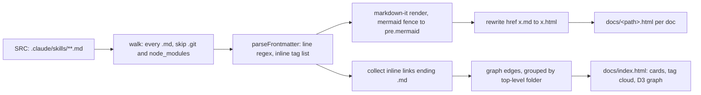

# Rendering skills to the wiki site

The same markdown that Claude reads is rendered into a static wiki by
[`tools/build-html.mjs`](https://github.com/hamsof/okf-skills-wiki/blob/main/tools/build-html.mjs)
in this repo. The renderer's parser is deliberately tiny, so a few
authoring rules exist only to keep it working. Those rules live in
[frontmatter-spec.md](frontmatter-spec.md), [cross-linking.md](cross-linking.md) and
[diagrams.md](diagrams.md); this page explains the pipeline they protect. Parent:
[SKILL.md](SKILL.md).

## Pipeline



## What each frontmatter field drives

| Field | Used for on the site | If missing |
|-------|----------------------|------------|
| `title` | page `<h1>`, card heading, graph node label | the file path is shown |
| `type` | badge colour (`index` gold, `reference` green), type filter, node colour | treated as `reference` |
| `tags` | chips on the page, tag cloud, `?tag=` filter | no chips, not findable by tag |
| `description` | text on the index card and graph hover card | blank card body |
| `name`, `resource`, `timestamp` | ignored by the renderer (`name` is still needed by Claude Code) | — |

## Build behaviour worth knowing

- `docs/` is **wiped and regenerated** on every build (`rmSync(OUT)`). Never hand-edit
  anything under `docs/`.
- Graph node size = number of links in and out. An orphan leaf shows up as a lone dot,
  which makes the "no orphans" rule easy to check by eye.
- Graph colour and the legend filter come from the **top-level folder** under `SRC`, so
  one skill = one colour group.
- Only the `markdown-it` package is needed. Mermaid v11 and D3 load from a CDN at view time.

## Running it

```bash
npm install
npm run build:site                      # → docs/, open docs/index.html
bash .claude/hooks/rebuild-site.sh --full
```

`.claude/settings.json` sets up a `PostToolUse` hook (matcher `Write|Edit|MultiEdit`)
that runs `rebuild-site.sh`. The script reads the hook JSON, rebuilds only when
`tool_input.file_path` is under `.claude/skills/`, and otherwise exits 0. That keeps
`docs/` in step with the skills.

To render another bundle, copy `build-html.mjs` and point `SRC` at it. The `docs/` output
is a static site that GitHub Pages can serve as-is.

## See also

- [checklist.md](checklist.md) — the renderer-compatibility gate.
